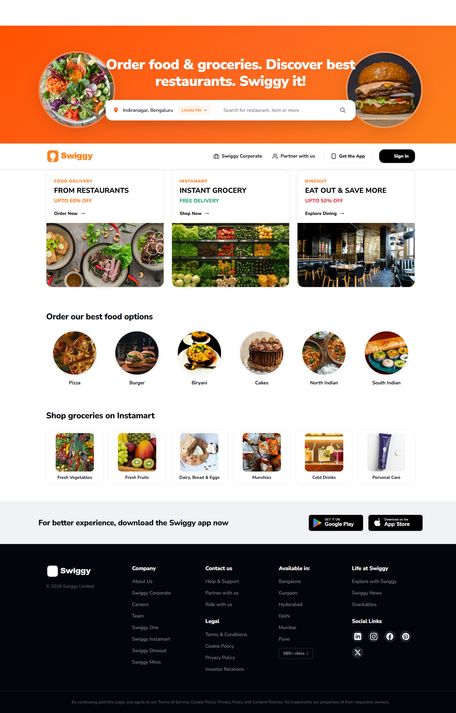
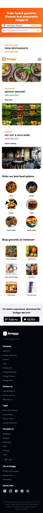

# Swiggy Landing Page Clone

This project is a responsive frontend clone of the Swiggy landing page built using only pure HTML5 and CSS3, without any JavaScript or external frameworks.


**Live Demo:** [https://kyogeshpandey.github.io/Swiggy_Clone/](https://kyogeshpandey.github.io/Swiggy_Clone/)

## Screenshots

- **Desktop View (1440px):**  
  

- **Tablet View (768px):**  
  

- **Mobile View (375px):**  
  

## Sections Included

- **Header / Navbar:** Swiggy logo, navigation links (Corporate, Partner), "Get the App" button, "Sign in" button, and a CSS-only hamburger toggle for mobile.
- **Hero Banner:** Orange gradient background with the main headline, side illustrations, delivery location input ("Locate Me"), and restaurant/item search bar.
- **Service Cards:** Three cards for Food Delivery, Instamart, and Dineout featuring discount badges, titles, and food photography.
- **Order our best food options:** A 6-item circular grid showcasing popular categories (Pizza, Burger, Biryani, Cakes, North Indian, South Indian).
- **Shop groceries on Instamart:** A 6-item rounded-card grid for grocery categories (Fresh Vegetables, Fruits, Dairy, Munchies, Cold Drinks, Personal Care).
- **App Promo Banner:** Call-to-action banner with official Google Play and App Store download badges.
- **Footer:** Multi-column dark footer with company links, contact & legal pages, deliverable cities, social media icons, and copyright details.

## How I Built It

1. **Semantic HTML Structure:** Structured the page using semantic tags (`<header>`, `<nav>`, `<main>`, `<section>`, `<article>`, `<footer>`).
2. **CSS Variables & Reset:** Set up root design tokens for colors, typography, border-radii, and a global `box-sizing: border-box` reset.
3. **Navbar with Flexbox:** Built the sticky header with flex alignments and a CSS-only checkbox hack for mobile toggle.
4. **Hero Section:** Styled the orange gradient hero, search container inputs, and positioned side illustrations.
5. **Cards & Grids with CSS Grid:** Created the service cards and 6-column category grids using `minmax(0, 1fr)` to avoid content blowout.
6. **Footer Layout:** Created a multi-column responsive grid layout with hover transitions for links and social icons.
7. **Responsive Pass & Polish:** Tuned breakpoints from 1440px down to 320px, added hover lifts, transitions, and confirmed zero horizontal scrolling.

## Responsive Design

| Breakpoint | Layout Adjustments |
|---|---|
| **Desktop (>= 1024px)** | Full navigation bar, side illustrations visible, 3 service cards row, 6-column category grids, 5-column footer. |
| **Tablet (max-width: 1023px)** | Secondary header links hide, hero illustrations hide for clean spacing, category grids switch to 3 columns, footer switches to 3 columns. |
| **Mobile (max-width: 767px)** | Hamburger menu toggles full drawer via CSS checkbox, search inputs stack vertically, service cards stack into 1 column, category grids switch to 3 columns. |
| **Small Mobile (max-width: 480px)** | Category grids collapse to 2 columns, footer collapses to 1 column, font sizes and paddings scale down. |

*No horizontal scrolling occurs at any width between 320px and 1920px.*

## Technologies Used

- **HTML5:** Semantic elements for accessibility and clean layout
- **CSS3:** Flexbox, CSS Grid, custom properties (variables), media queries, and transitions
- **Google Fonts:** Nunito Sans
- **Pure CSS/SVG:** Zero JavaScript, no CSS frameworks (no Bootstrap, no Tailwind)
- Built with the assistance of Antigravity (AI coding assistant), then reviewed, tested, and adjusted by me

## Folder Structure

```text
Swiggy_clone/
├── index.html
├── style.css
├── README.md
├── assets/
│   ├── icons/        # SVG icons (logo, search, location, social links)
│   └── images/       # Food, grocery, service card photos, and store badges
└── screenshots/
    ├── desktop.png   # Full-page desktop capture (1440px)
    ├── tablet.png    # Full-page tablet capture (768px)
    └── mobile.png    # Full-page mobile capture (375px)
```

## How to Run

1. Clone or download this repository.
2. Double-click `index.html` or open it in any modern web browser (Chrome, Firefox, Safari, Edge).
3. No build tools, package managers, or local server installations are needed.

## Challenges and Learnings

- **CSS-Only Mobile Navigation:** Building a collapsible mobile menu without JavaScript required using the checkbox hack (`<input type="checkbox">` and the `:checked ~ nav` selector) while keeping it clean and accessible.
- **Preventing Grid Overflow:** Default grid item sizing (`min-width: auto`) caused layout overflow on narrower desktop widths; switching to `minmax(0, 1fr)` solved the issue completely.
- **Aspect Ratio & Image Sizing:** Setting explicit `max-width`, aspect ratios, and `object-fit: cover` prevented layout shifts and ensured images scale smoothly across resolutions.
- **Zero Horizontal Scrolling:** Managing absolute hero decorations and padding at smaller viewports required `contain: paint` and disciplined media query rules to maintain zero horizontal scroll from 320px to 1920px.
